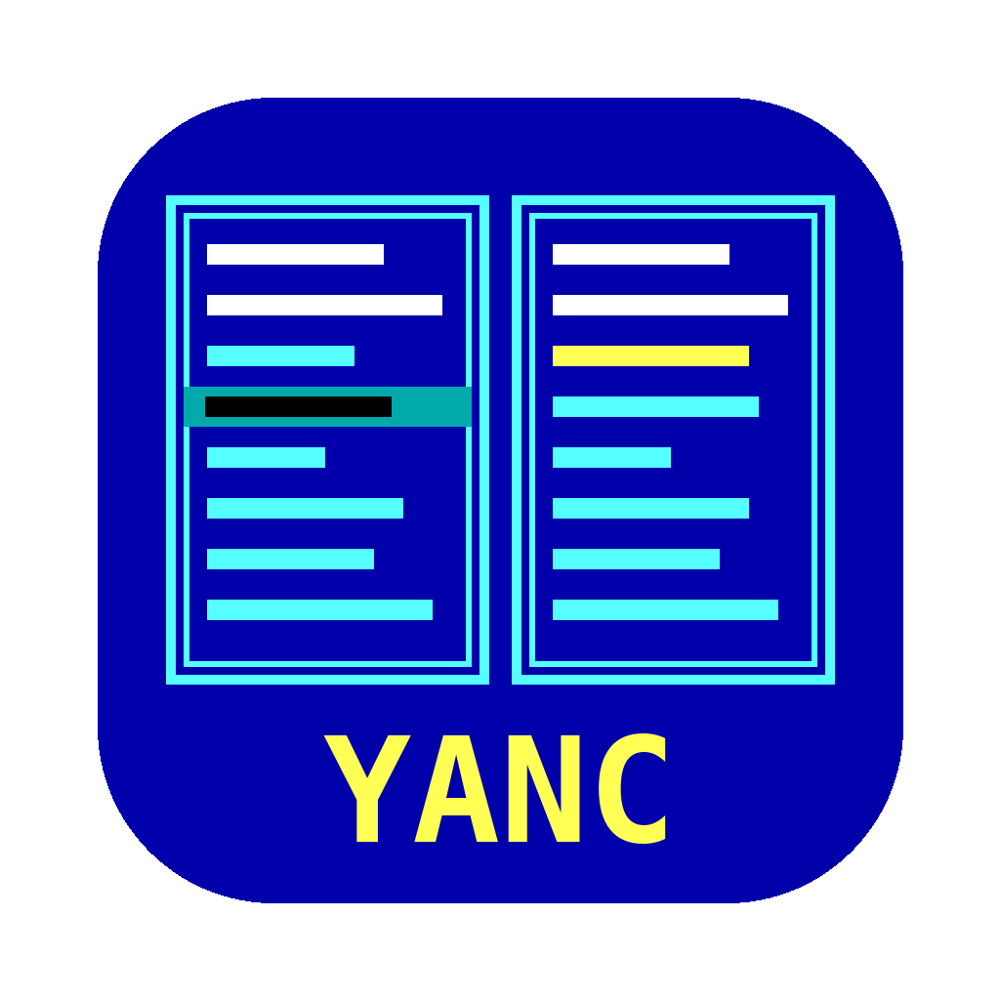

# YANC for Mac

A Norton Commander style, two-panel file manager for macOS that reads and writes
Apple II disk images: **ProDOS** (`.po`, `.hdv`, `.2mg`, `.dsk`, `.do`) and **DOS 3.3** (140K `.dsk` / `.do` / `.po`).
Each panel shows either a Mac folder or the inside of a disk image – copy files between them
with F5, just like on the Apple II with [YANC](https://github.com/udiweinstein/YANC).

## Features
- Two panels: Mac folder ↔ disk image, image ↔ image, or Mac ↔ Mac
- Browse subdirectories inside images; Return on an image opens it
- Copy (F5), move / rename (F6), make directory (F7), delete (F8) – recursive for directories
- View files (F3): Apple II text or a hex dump
- Create blank images (File › New Disk Image, Cmd-N, or F9): ProDOS 140K, 800K or 32 MB, or a DOS 3.3 140K data disk
- **Make a ProDOS image bootable** (File › Make Bootable, Cmd-B): with a bootable ProDOS disk
  (e.g. the ProDOS 2.4.3 disk from prodos8.com) open in the other panel, it copies the boot blocks,
  `PRODOS` and – if the target has none – the first `.SYSTEM` program. Works for floppies and 32 MB hard disk images.
- DOS 3.3 files convert on copy: B ↔ BIN (load address kept as aux type), A ↔ BAS, I ↔ INT, T ↔ TXT
- File types are kept: files copied to the Mac get a CiderPress-style suffix
  (`PRODOS#FF2000` = type `$FF`, aux `$2000`), which is used again when copying back.
  Plain Mac files get a type from their extension (`.txt` → TXT with LF→CR, `.bas`, `.sys`, otherwise BIN).
- Locked files are marked with `*`



## What's new
**1.1.0**
- DOS 3.3 support: open, browse, copy to and from, delete and rename on 140K DOS 3.3 disks; create blank DOS 3.3 data disks
- File › Make Bootable (Cmd-B): turns a ProDOS image into a bootable disk
- File menu: New Disk Image (Cmd-N) and Make Bootable (Cmd-B)

**1.0.0** – first release: ProDOS images, two panels, copy/move/rename/delete/mkdir, view, new images, update check

## Download
Get the latest zip from [Releases](https://github.com/udiweinstein/yancformac/releases/latest),
unzip it and move **YANC for Mac** to Applications.

The app is not notarized, so on first launch right-click it and choose **Open** (or run
`xattr -dr com.apple.quarantine "YANC for Mac.app"`).
Requires macOS 14 or newer on an Apple Silicon Mac.

**YANC for Mac → Check for Updates…** tells you when a newer version is out.

## Requirements for building
macOS 14 or newer with the Swift 5.9+ command-line tools (`xcode-select --install`) or Xcode 15+.

## Build and run
```
swift run SelfTest  # runs the ProDOS and DOS 3.3 engine tests (no Xcode needed)
swift run YANCMac   # starts the app from the terminal
./make-app.sh       # builds "YANC for Mac.app" (version from the VERSION file, icon from Icon/AppIcon.png)
```
Or open `Package.swift` in Xcode and press Run.

## Keys
| Key | Action |
|---|---|
| Arrows, PgUp/PgDn, Home/End | move |
| Tab | other panel |
| Return | enter folder / open image |
| Esc or Delete | go up |
| Space | tag; `+` `-` `*` tag all / none / invert |
| Ctrl-R / Ctrl-U | re-read / swap panels |
| F1 Help · F3 View · F5 Copy · F6 Move/Rename · F7 Mkdir · F8 Delete · F9 New image · F10 Quit | also the digit keys 1–0 |

## Structure
- `Sources/ProDOSKit` – the disk engines (no UI): ProDOS and DOS 3.3,: block access for ProDOS/DOS order and 2IMG,
  directories, seedling/sapling/tree files, bitmap allocation
- `Sources/YANCMac` – the SwiftUI app
- `Sources/SelfTest` – engine tests (a plain program, works with the Command Line Tools alone)

## Limits
ProDOS and DOS 3.3 only (no Pascal, CP/M or HFS); extended (forked) files are read
as their data fork only; nibble images (.nib, .woz) are not supported; DOS 3.3 on 140K disks only.

## Releasing a new version
1. Bump the number in `VERSION` (and `fallbackVersion` in `Sources/YANCMac/UpdateChecker.swift`).
2. `./make-app.sh`, then compress the app and attach the zip to a new GitHub Release.
3. Push `VERSION` – the app's update check reads it from the `main` branch.

## License
MIT – see [LICENSE](LICENSE).
